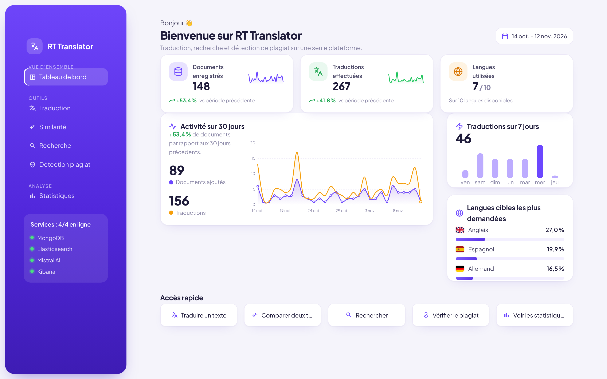
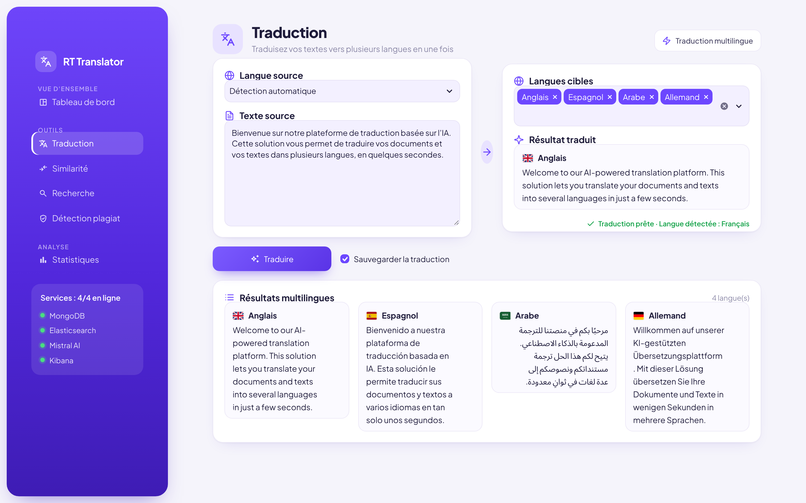
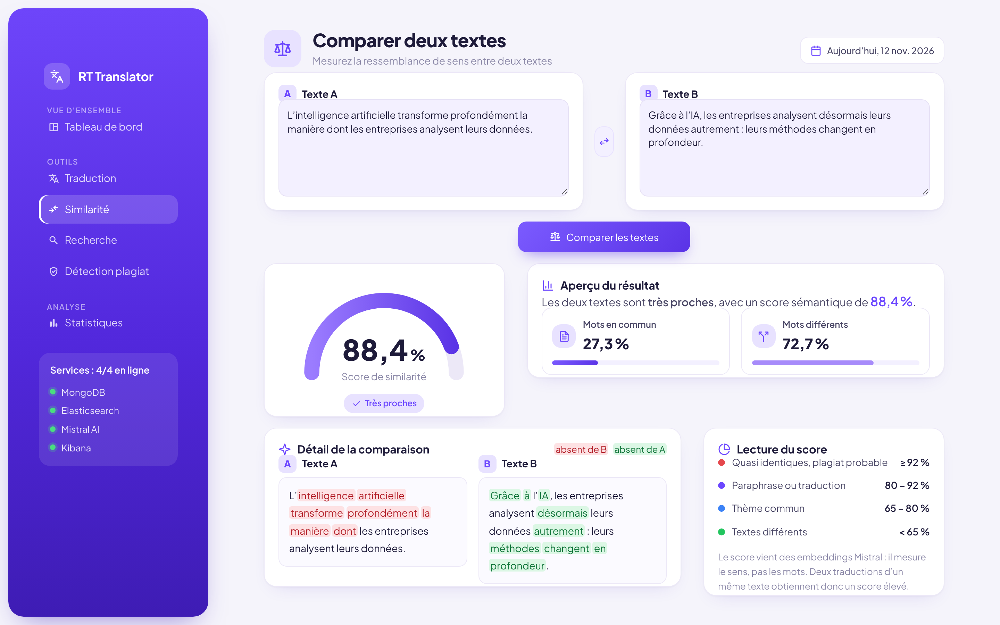
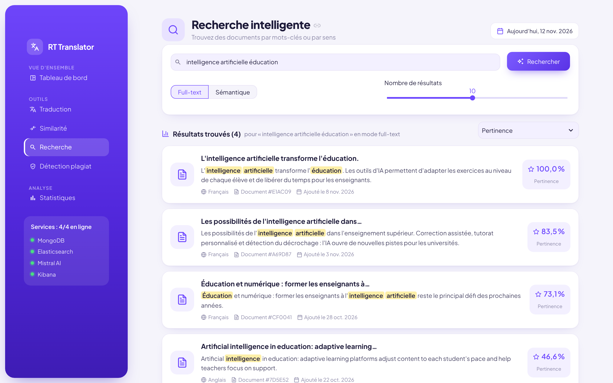
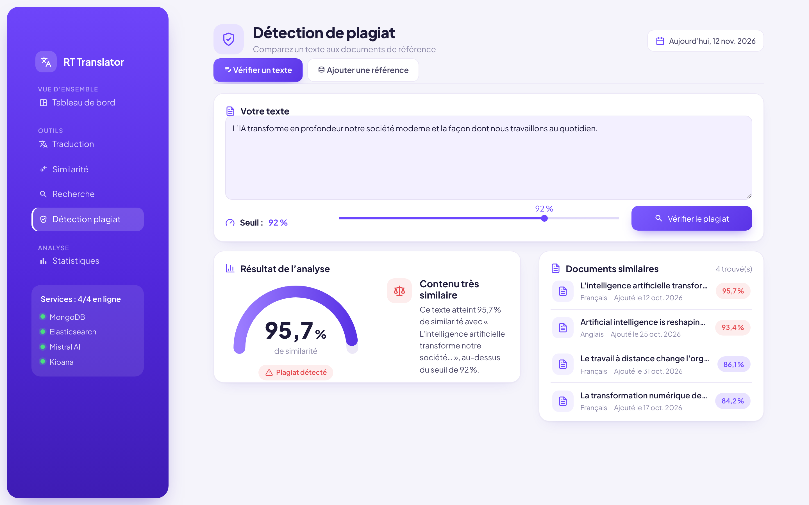
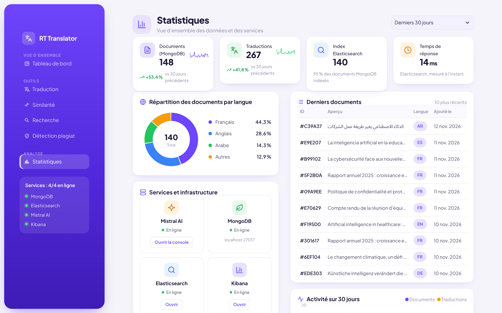
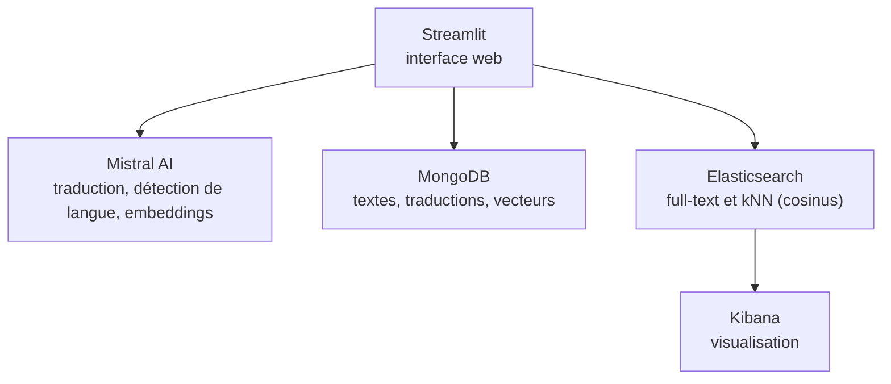

# RT Translator

Plateforme web de **traduction multilingue**, de **recherche sémantique** et de **détection de plagiat**, construite avec Mistral AI, Elasticsearch, MongoDB et Streamlit.

Projet réalisé dans le cadre du Mini Projet 3 (Big Data).



## Fonctionnalités

- **Traduction** : un texte traduit vers une ou plusieurs langues parmi 10 (français, anglais, espagnol, allemand, italien, portugais, arabe, russe, chinois, japonais), avec détection automatique de la langue source. L’arabe s’affiche de droite à gauche.
- **Similarité** : un score sémantique entre deux textes, calculé à partir des embeddings Mistral, avec le surlignage des mots qui diffèrent.
- **Recherche** : en mode full-text (Elasticsearch) ou sémantique (recherche vectorielle kNN), avec les termes trouvés surlignés.
- **Détection de plagiat** : un texte comparé à une base de références, y compris quand il a été traduit dans une autre langue.
- **Statistiques** : documents, traductions, répartition par langue et état des services.

## Captures d’écran

Les captures ci-dessous ont été réalisées avec des données de démonstration.

| Traduction | Similarité |
|---|---|
|  |  |

| Recherche | Détection de plagiat |
|---|---|
|  |  |

| Statistiques |
|---|
|  |

## Architecture



Chaque texte traité est enregistré dans MongoDB avec ses traductions et son embedding (1 024 dimensions, modèle `mistral-embed`), puis indexé dans Elasticsearch. Ce même vecteur sert à la recherche sémantique et à la détection de plagiat.

## Technologies

| Rôle | Outil |
|---|---|
| Interface | Streamlit |
| Traduction et embeddings | Mistral AI (`mistral-small-latest`, `mistral-embed`) |
| Stockage | MongoDB |
| Recherche full-text et vectorielle | Elasticsearch 9 |
| Visualisation | Kibana |
| OCR (module `ocr.py`) | Tesseract, via `pytesseract` |

## Installation

### Prérequis

- Python 3.10 ou plus récent
- MongoDB (port 27017)
- Elasticsearch 9 (port 9200) et, en option, Kibana (port 5601)
- Une clé API Mistral : <https://console.mistral.ai>
- Pour l’OCR uniquement : [Tesseract](https://github.com/tesseract-ocr/tesseract)

Si Docker est installé, les trois services peuvent être lancés ainsi :

```bash
docker run -d --name mongo -p 27017:27017 mongo:7
docker run -d --name elasticsearch -p 9200:9200 -e "discovery.type=single-node" -e "xpack.security.enabled=false" docker.elastic.co/elasticsearch/elasticsearch:9.0.0
docker run -d --name kibana -p 5601:5601 -e "ELASTICSEARCH_HOSTS=http://host.docker.internal:9200" docker.elastic.co/kibana/kibana:9.0.0
```

> L’application se connecte à Elasticsearch sur `http://localhost:9200` sans authentification (voir `config.py`). La sécurité d’Elasticsearch doit donc être désactivée en local, comme dans la commande ci-dessus.

### Étapes

1. Cloner le dépôt :

   ```bash
   git clone https://github.com/chaimae-essalhi/real-Time-translator.git
   cd real-Time-translator
   ```

2. Créer et activer un environnement virtuel :

   ```bash
   # Windows (PowerShell)
   python -m venv venv
   .\venv\Scripts\Activate.ps1

   # macOS / Linux
   python3 -m venv venv
   source venv/bin/activate
   ```

3. Installer les dépendances :

   ```bash
   pip install -r requirements.txt
   ```

4. Configurer les variables d’environnement : copier `.env.example` en `.env`, puis renseigner la clé Mistral et les accès.

   ```bash
   # Windows
   copy .env.example .env

   # macOS / Linux
   cp .env.example .env
   ```

## Exécution

1. Vérifier que les services répondent :

   ```bash
   python test_setup.py
   ```

2. Lancer l’application :

   ```bash
   streamlit run app.py
   ```

3. Ouvrir <http://localhost:8501> dans le navigateur.

## Structure du projet

```
real-Time-translator/
├── app.py               # Interface Streamlit (6 pages)
├── config.py            # Chargement du .env et clients MongoDB / Elasticsearch
├── translator.py        # Traduction et détection de langue (Mistral)
├── embeddings.py        # Embeddings et similarité cosinus
├── search.py            # Index Elasticsearch, recherche full-text et kNN
├── storage.py           # Lecture et écriture dans MongoDB
├── plagiarism.py        # Détection de plagiat
├── ocr.py               # Extraction de texte depuis une image (Tesseract)
├── test_setup.py        # Vérification des services
├── requirements.txt
├── .env.example         # Modèle de configuration
├── .streamlit/
│   └── config.toml      # Thème de l’interface
└── docs/screenshots/    # Captures d’écran du README
```

## Choix techniques

- **Seuil de plagiat à 0,92.** Avec `mistral-embed`, deux textes sans rapport obtiennent déjà une similarité de 0,70 à 0,85. Un seuil plus bas produirait trop de faux positifs.
- **Gestion des limites de l’API.** En cas d’erreur 429 (forfait gratuit saturé), la création d’embeddings est relancée automatiquement après 2, 4, 8, 16 puis 32 secondes.

## Auteur

[@chaimae-essalhi](https://github.com/chaimae-essalhi)
